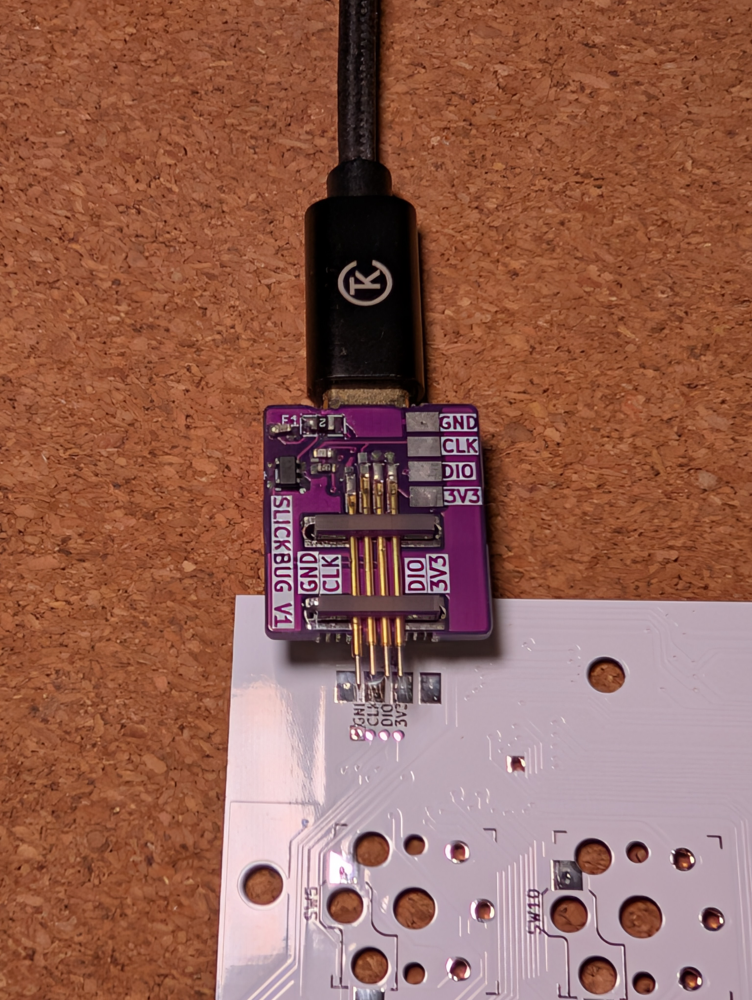
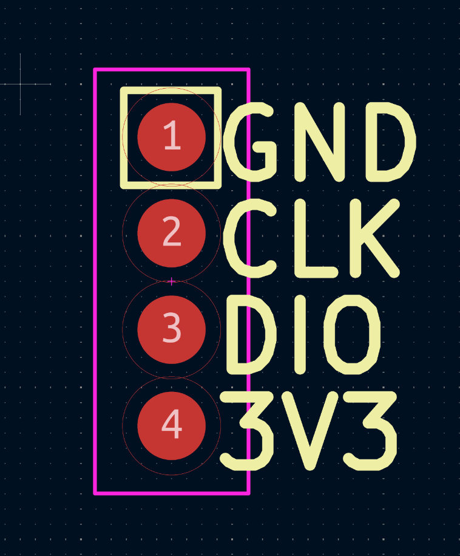
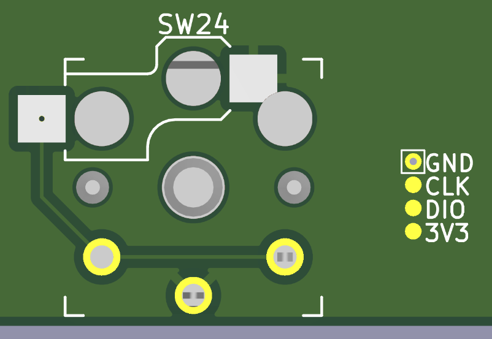
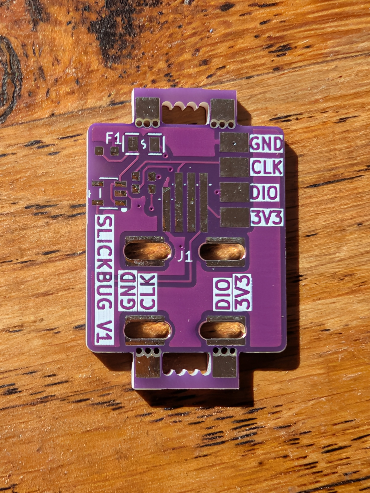
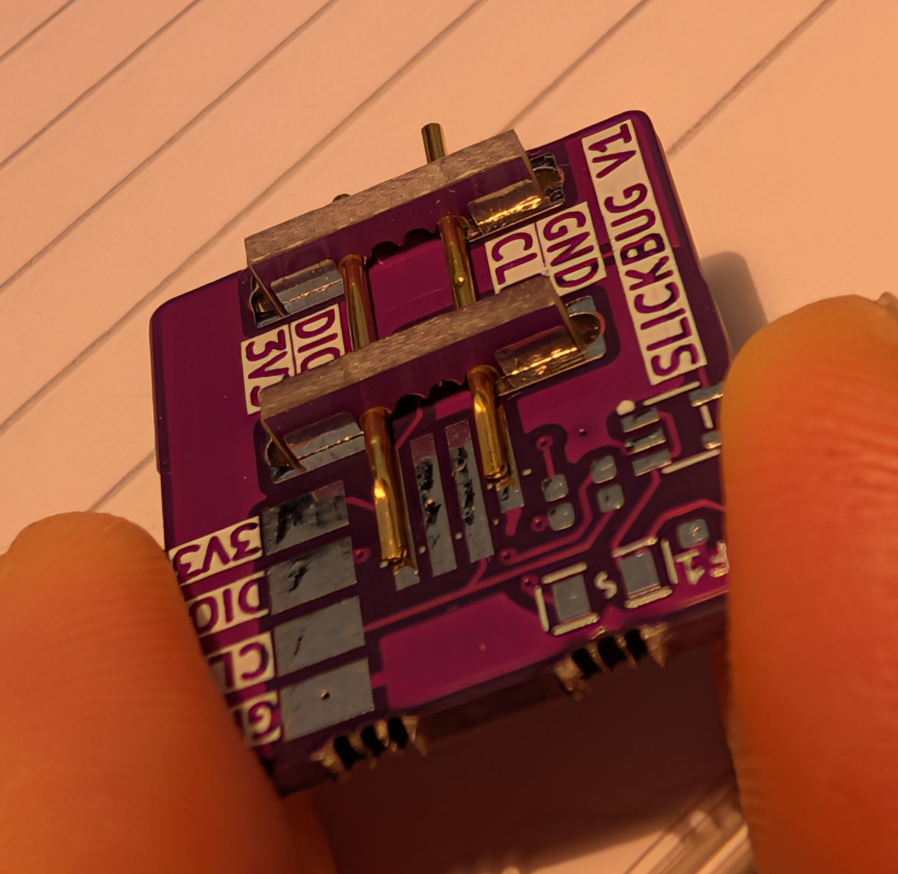

# SlickBug

A small SWD programmer using the Seeed Studio XIAO RP2040.
I wanted a compact debugger with a tiny target footprint (roughly 4.8mm by 1.1mm).

It uses four R50 test probe receptacles which are mounted on the back of the PCB and are held in place using two PCB "combs".
P50 test probes sit in the R50 receptacles.  The GND pin extends 1.5mm further so that GND connects first.

  
  
  

## Target footprint

The target footprint is 4 pads with pitch 1.27mm:

|  |   |  |
| :---: | :---: | :---: |
| PCB footprint with guiding hole | PCB footprint SMD only | Target footprint next to a MX keyswitch |

### Installing the target footprint

A standalone KiCad library containing only the target symbol and footprint is located in [`hardware/slick_bug_target/`](hardware/slick_bug_target/)

Add it to your KiCad project with:
1. Copy [`hardware/slick_bug_target/`](hardware/slick_bug_target/) into your project (or add this repo as a submodule).
2. Register the `Footprint Library`: Go to `Preferences->Manage Footprint Libraries`, click the folder icon, and select [`hardware/slick_bug_target/slick_bug_target.pretty`](hardware/slick_bug_target/slick_bug_target.pretty)
3. Register the `Symbol Library`: Go to `Preferences->Manage Symbol Libraries`, add [`hardware/slick_bug_target/slick_bug_target.kicad_sym`](hardware/slick_bug_target/slick_bug_target.kicad_sym)
4. Place `slick_bug_target:Conn_SWD_SlickBug_V1` in your schematic. It already has `slick_bug_target:SlickBug_Target_V1` pre-assigned as its footprint.

### Ordering and assembly

Drag the [production files](hardware/production/slick_bug.zip) to JLCPCB's order page to get the PCBs. 1.6mm thick so that the combs work as intended.

You can get the [components](hardware/production/bom.csv) from LCSC and combine your order with JLCPCB. I bought the test probes and receptacles from AliExpress.

You will need to snap off the combs from the pcb to hold the R50 receptacles in place.

|  |  |
| :---: | :---: |
| SlickBug PCB | Partly assembled |

### Firmware

SlickBug uses the same SWD GPIO pins (`GPIO 2` = SWCLK, `GPIO 3` = SWDIO) as a Raspberry Pi Pico, so it runs the unmodified official [**`debugprobe_on_pico.uf2`**](https://github.com/raspberrypi/debugprobe/releases/latest) firmware (also included in [`firmware/debugprobe_on_pico.uf2`](firmware/debugprobe_on_pico.uf2)):

1. Put the XIAO RP2040 into BOOTSEL mode (hold **`B`**, tap **`R`**, release **`B`**).
2. Copy [`firmware/debugprobe_on_pico.uf2`](firmware/debugprobe_on_pico.uf2) onto the `RPI-RP2` drive.
